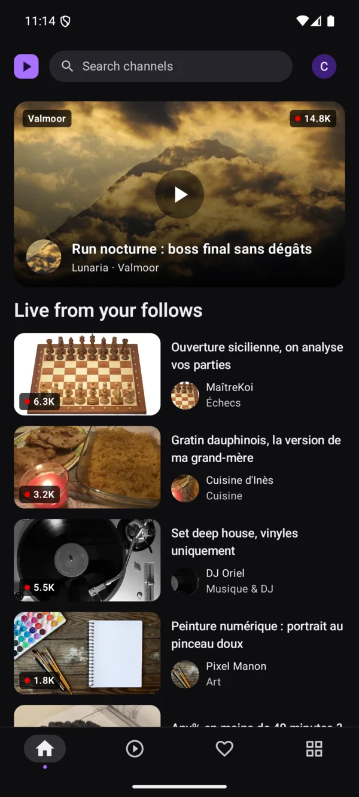
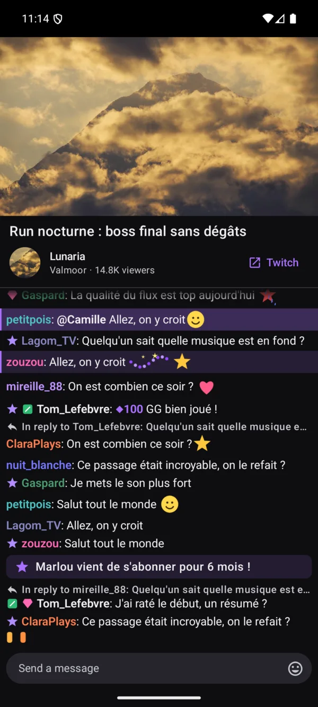
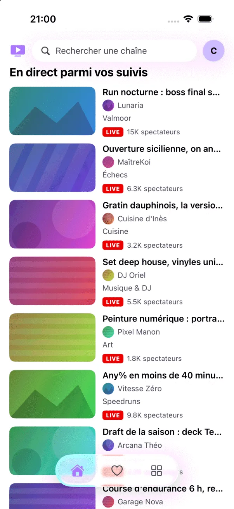
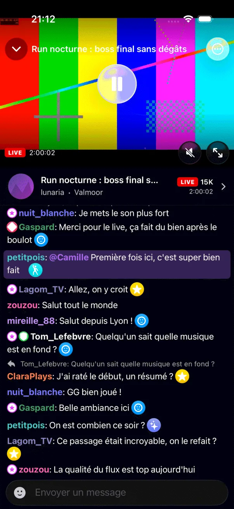
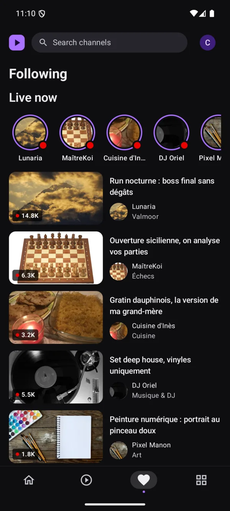
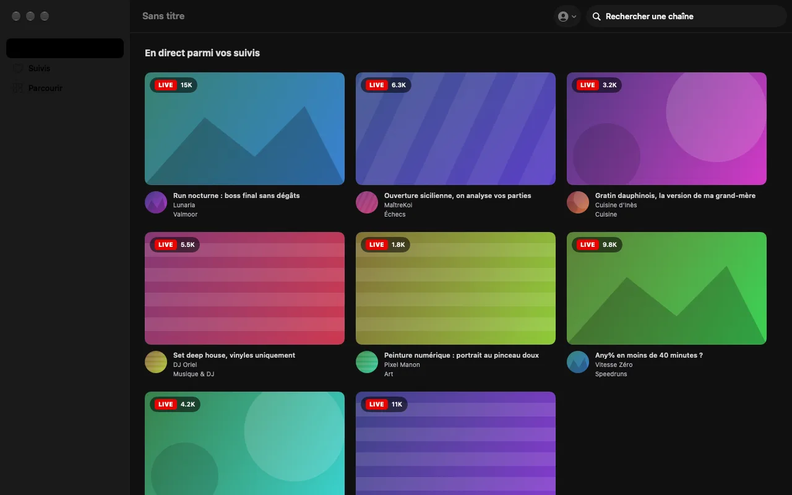
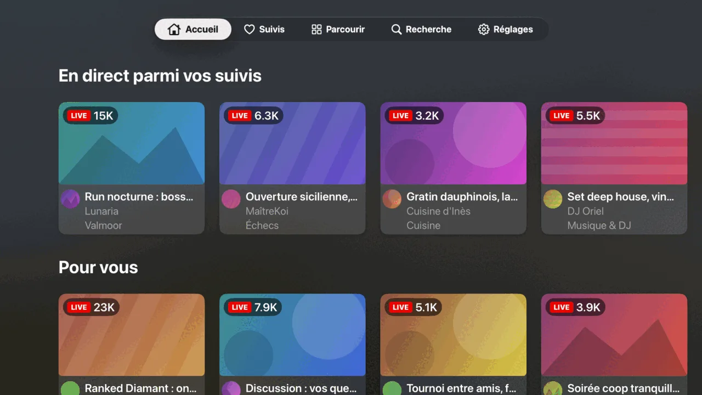

<h1 align="center">Skerry</h1>

<p align="center"><strong>A native, open-source client for Twitch on Android, iPhone, Mac and Apple TV.</strong><br>
One shared Kotlin Multiplatform core, native UIs on top.</p>

<p align="center">
  <a href="https://deuspheara.github.io/skerry/">Website</a> ·
  <a href="#build">Build</a> ·
  <a href="LEGAL.md">Legal</a> ·
  <a href="PRIVACY.md">Privacy</a> ·
  <a href="CONTRIBUTING.md">Contributing</a>
</p>

<p align="center">
  
  
  
  
  
</p>
<p align="center">
  
  
</p>
<p align="center"><sub>Demo mode: fictional channels, chat and a test-pattern video. No real streamers appear in any screenshot.</sub></p>

> **Unofficial project.** Skerry is not affiliated with, endorsed by, or sponsored by Twitch Interactive, Inc. or Amazon.com,
> Inc. Twitch and the Twitch logo are trademarks of their owners. See [LEGAL.md](LEGAL.md).

## Hi, this is Skerry

Skerry is a Twitch viewer that feels at home on each device. On your phone it behaves like a phone app, on a Mac like a Mac app,
on a TV like a TV app, and all of them share the same brain underneath. It is a hobby project, built in the open, and it is
happy to have company.

- **Browse and watch.** Your followed channels that are live, categories, search, channel pages, replays and clips.
- **Chat that is fun to read.** Badges, replies, highlighted mentions, and 7TV, BetterTTV and FrankerFaceZ emotes, animated ones included.
- **Speaks your language.** 36 languages, right-to-left layouts, large-text support.
- **Fast.** Baseline Profiles and R8 on Android; the numbers are tracked in [docs/](docs/perf-baseline.md).
- **Try it without an account.** Demo mode fills every screen with fictional channels, chat and a test-pattern video.

| Device | UI | Status |
|---|---|---|
| Android phone | Jetpack Compose | Working: browse, chat, replays, clips, Picture-in-Picture |
| Android TV | Jetpack Compose | Working: official embedded player by default |
| iPhone | SwiftUI | Working: draggable player sheet, Liquid Glass bar |
| Mac | SwiftUI | Working: sidebar, chat column, mini player |
| Apple TV | SwiftUI | Working: built for the Siri Remote |

## Try it in five minutes (Android phone, demo mode)

You need JDK 21 and the Android SDK, plus an emulator or a phone with USB debugging.

```sh
git clone https://github.com/Deuspheara/skerry.git
cd skerry
cp local.properties.example local.properties     # then set sdk.dir to your Android SDK
./gradlew :phone:assembleDebug
ANDROID_SERIAL=<your device> ./gradlew :phone:installDebug
adb -s <your device> shell run-as com.twitchplayer.phone touch files/demo    # turns on demo mode
```

Open the app again and you will see fictional channels, chat and a test-pattern video. No account, no network. The Apple apps are
in [apple/README.md](apple/README.md).

## Good to know

**Is this allowed by Twitch?** Skerry is unofficial and Twitch has not approved it. Sign-in, lists and chat use Twitch's documented
APIs. Playing video natively uses interfaces Twitch does not document, which may go against Twitch's terms, so this repository
does **not** include the key it needs: the Android TV app plays Twitch's own embedded player by default, and the other apps only
play video if *you* build them with your own `playbackClientId` (in `~/.gradle/gradle.properties` or `-PplaybackClientId=...`, or
`TWITCH_PLAYBACK_CLIENT_ID` in `apple/Config/Local.xcconfig`). That is your call and your risk. Ads are never skipped or hidden.
The full, plain-language version is in [LEGAL.md](LEGAL.md).

**What does it know about me?** Nothing leaves your device except requests to Twitch and the emote services. No account of its own, no analytics,
no server. See [PRIVACY.md](PRIVACY.md).

**Can I help?** Yes, please. Bug reports, translations, screenshots from real devices (we have no Android TV shots yet) and pull requests are all
welcome. Start with [CONTRIBUTING.md](CONTRIBUTING.md); the rules for everyone are in [AGENTS.md](AGENTS.md). Found a security problem?
See [SECURITY.md](SECURITY.md).

**Why "Skerry"?** A skerry is a small rocky island, a good spot to watch from.

---

## Developer guide

Everything below is for people building or changing the code.

<details>
<summary>All the Gradle commands (checks, benchmarks, profiles)</summary>

```sh
./gradlew :app:assembleDebug
./gradlew check                                  # spotless (ktlint), detekt, Android Lint, verifyCommonMain, all unit tests (shared + app)
./gradlew spotlessApply                          # fix formatting
./gradlew verifyCommonMain                       # no Android / java.* APIs in any shared commonMain
./gradlew :app:testDebugUnitTest
./gradlew :app:connectedDebugAndroidTest        # D-pad / focus / Back UI tests (emulator or TV)
./gradlew :app:assembleBenchmark                # release-like build (R8) on demo data, used by :benchmark
ANDROID_SERIAL=emulator-5554 ./gradlew :benchmark:connectedBenchmarkAndroidTest   # Macrobenchmark startup + frame timing
benchmark/tools/generate-profiles.sh            # regenerate the Baseline + startup profiles (emulator) into app/src/main/baselineProfiles/
ANDROID_SERIAL=<tv> benchmark/tools/install-release.sh   # release build on a TV, AOT-compiled at install with its profile
./gradlew :app:analyzeReleaseR8Config           # R8 Configuration Analyzer report (app/build/reports/r8/)
```

</details>

## Modules

| Module | What it is |
|---|---|
| `app` | Android TV UI (Jetpack Compose), Media3 and WebView players, Android implementations of the platform interfaces, Koin wiring, demo data |
| `phone` | Android phone UI (Jetpack Compose, Material 3): Home, Browse, Category, Search, Channel, Settings, sign-in, and native playback (live with chat, replays, clips, fullscreen, Picture-in-Picture; needs `playbackClientId`, see above) |
| `platform-android` | Android library, no UI: Android implementations of the platform interfaces, the Koin wiring, holder ViewModels, the Media3 player |
| `demo-android` | fictional demo data (no account, no network) and its video asset; debug, benchmark and nonMinified builds only |
| `shared/core` | Kotlin Multiplatform: models, Twitch API and auth, repositories, settings, platform interfaces |
| `shared/stream` | stream, VOD and clip resolvers (GQL token, usher, master playlist) |
| `shared/chat` | EventSub chat client, emote providers, chat assets |
| `shared/player-api` | `VideoPlayer` interface and playback models |
| `shared/presenters` | one presenter per screen: `StateFlow<UiState>` plus `onEvent(...)` |
| `shared/testing` | fakes shared by the tests |
| `benchmark` | TV Macrobenchmark and Baseline Profile generation |
| `benchmark-phone` | the same for the phone (touch journeys, startup and frame timing, profile generator) |

Dependency direction: `app` and `phone` -> `platform-android` -> `presenters` -> `chat`, `stream`, `player-api` -> `core`. Shared code has no Android or
`java.*` APIs (`./gradlew verifyCommonMain` enforces it). See [architecture](docs/ARCHITECTURE.md), the
[presenter pattern](docs/PRESENTERS.md), the [migration log](docs/kmp-migration-log.md), the
[performance baseline](docs/perf-baseline.md) and its [post-migration numbers](docs/perf-after-phase1.md), and the
[localization plan](docs/LOCALIZATION_PLAN.md).

### Phone app

```sh
./gradlew :phone:assembleDebug                      # debug build (applicationId com.twitchplayer.phone)
./gradlew :phone:installDebug                       # install on the device in ANDROID_SERIAL (set it: Gradle installs on every adb device)
./gradlew :phone:testDebugUnitTest                  # navigator, sign-in, player policies, strings parity, Koin graph
ANDROID_SERIAL=emulator-5554 ./gradlew :phone:connectedDebugAndroidTest   # Compose UI tests on the demo data (emulator or phone)
./gradlew :phone:assembleRelease :phone:bundleRelease   # R8 full mode, unsigned; sign it yourself to install
ANDROID_SERIAL=emulator-5554 ./gradlew :benchmark-phone:connectedBenchmarkAndroidTest   # startup + frame timing, no profile vs Baseline Profile
benchmark-phone/tools/generate-profiles.sh          # regenerate the Baseline + startup profiles into phone/src/main/baselineProfiles/
python3 -I benchmark/tools/check-profile-packaging.py phone phone   # after assembleRelease + bundleRelease: profile packaged, startup classes in classes.dex
adb -s <serial> shell run-as com.twitchplayer.phone touch files/demo      # demo data in a debug build (restart the app)
```

**Demo mode.** A debug build shows fictional channels, chat and a looping test-pattern clip (no account, no network) once the file
`files/demo` exists in its data folder (the `touch` line above, then restart the app); the `benchmark` and `nonMinified` builds are
always on the demo data and are never shipped. Debug-only fixtures `files/demo-offline`, `files/demo-empty` and `files/demo-stream-offline`
show the error, empty and offline pages. A release build never contains the demo code (CI checks the R8 mapping and the APK).

**Screenshots** (emulator, demo data): [docs/screenshots/phone/](docs/screenshots/phone/); what was built, decided and measured:
[the phone log](docs/phone-log.md) and [phone performance](docs/perf-phone.md).

The phone app reuses the TV app's 36 translations (generated at build time, nothing copied) and adds English and French for its own strings.

### Tests

```sh
./gradlew :shared:presenters:jvmTest             # presenter tests on the JVM (fast, no Android needed)
./gradlew :shared:presenters:testAndroidHostTest # the same tests against the Android target
./gradlew allTests                               # every shared module, jvm + Android host
./gradlew :app:testDebugUnitTest                 # app-side tests (holder ViewModels, Koin graph, Android implementations)
```

Connected Gradle tasks install on every adb device: set `ANDROID_SERIAL` so they never replace the release build on a TV.

Demo data (no account, no network; fictional channels): in a debug build run `adb shell run-as com.twitchplayer.tv touch files/demo` and restart the app. Demo chat has fictional 7TV / BTTV / FFZ style emotes (stills, animated GIFs, zero-width overlays) drawn in code; `adb shell run-as com.twitchplayer.tv touch files/demo-chat-heavy` (debug) or `adb shell settings put global twitchtv_demo_chat_heavy 1` (benchmark build) switches it to ~16 messages/s. `benchmark/tools/chat-load.sh` and `chat-memory.sh` measure it (see [performance notes](docs/PERFORMANCE.md)). See [architecture](docs/ARCHITECTURE.md), [design system](docs/DESIGN_SYSTEM.md) and [performance notes](docs/PERFORMANCE.md).

The public Twitch Client ID is in `gradle.properties`. Client IDs identify the OAuth app and are public; do not add a client secret. OAuth uses Twitch Device Code Grant. Tokens are encrypted with AES-GCM using an Android Keystore key.

## Player setup

The static player page is in `player-site/`. Host it over HTTPS on a domain you control, then set `twitchPlayerHost` to its HTTPS origin and `twitchPlayerParent` to the exact hostname in `gradle.properties`. See [player hosting notes](docs/PLAYER_HOSTING.md). No video proxy is involved.

The app currently builds and runs on the Android TV emulator. Device-code auth and followed streams have been exercised with Twitch. EventSub chat reaches the connected state; live message delivery and sending still need full account/channel validation. The player remains unavailable until the hosted page is deployed and Twitch confirms this WebView distribution model. Emulator playback is not treated as TV hardware validation.

This is an independent, unofficial client and is not endorsed by Twitch.

## License

[Apache License 2.0](LICENSE), see [NOTICE](NOTICE). The licence grants no trademark rights. Emotes belong to their creators and
are loaded at runtime from the providers; nothing from Twitch is bundled.
